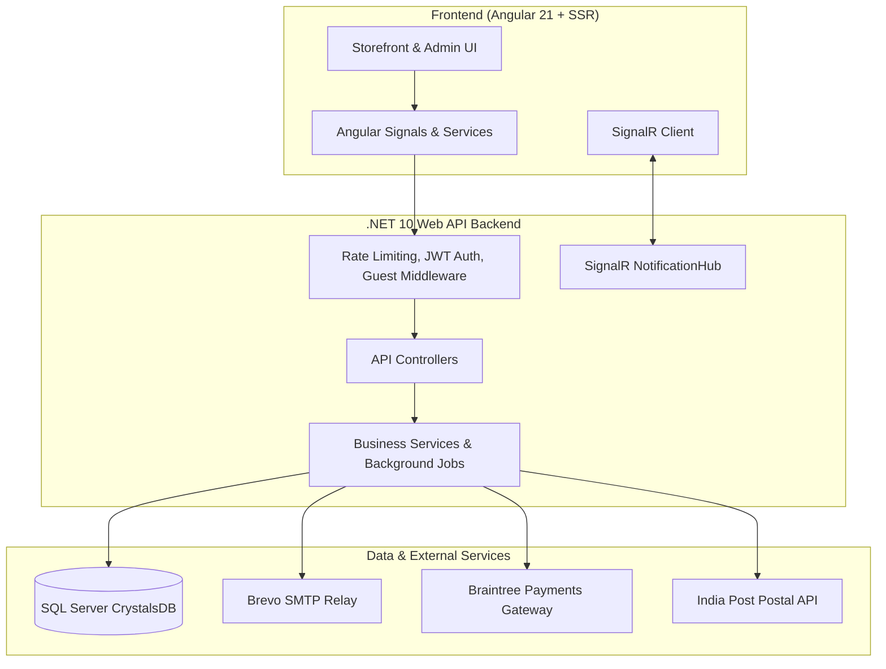
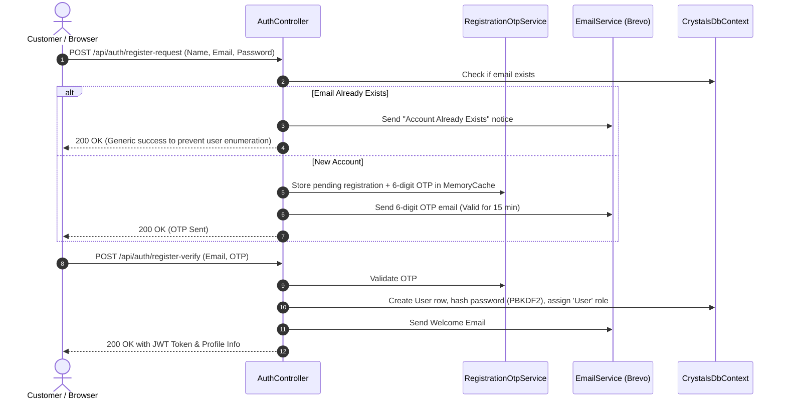
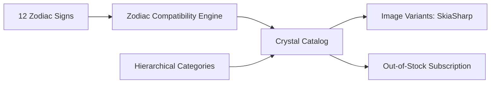
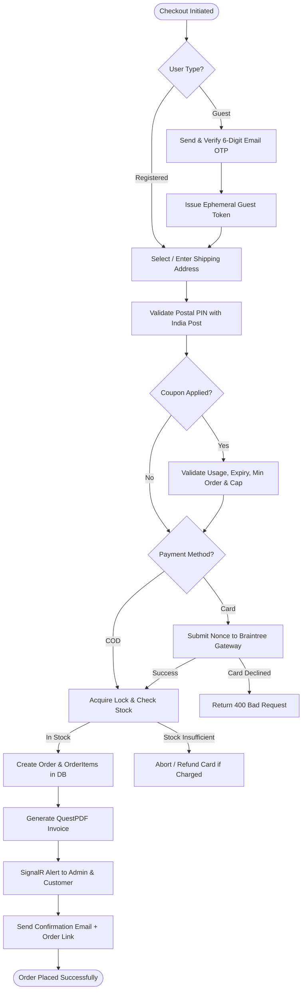
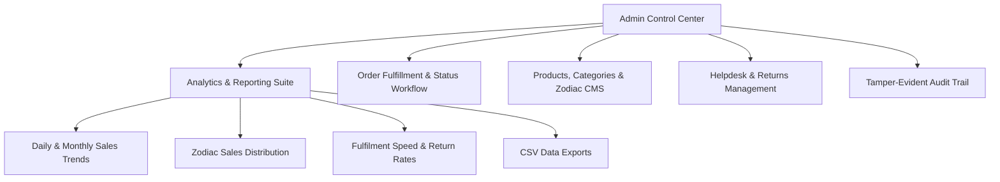
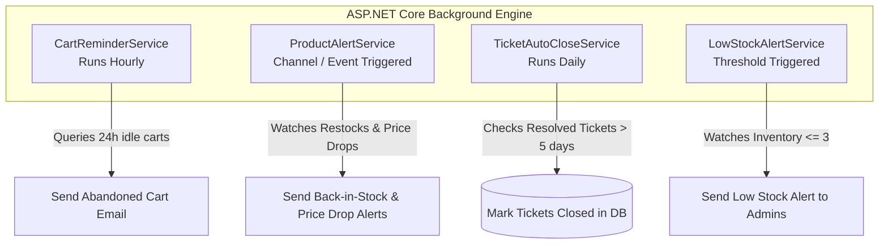
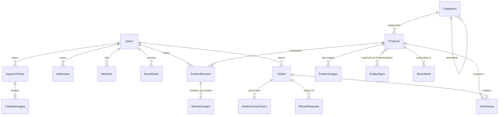
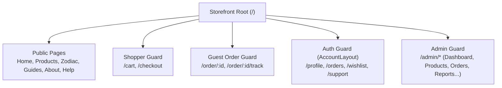

# Zodiac Crystals — Full Project Documentation (Frontend & Backend)

---

## 1. Executive Summary & Tech Stack Overview

**Zodiac Crystals** is an e-commerce platform specializing in healing crystals, gemstone jewelry, and mystery boxes curated by astrological zodiac signs. The application features a decoupled architecture with an **Angular 21** frontend, an **ASP.NET Core 10 (.NET 10)** backend API, and a **Microsoft SQL Server** database.



### Technology Matrix

| Layer | Technologies & Libraries | Key Responsibilities |
|---|---|---|
| **Frontend** | Angular 21 (Standalone Components, Signals, SSR), TypeScript 5.9, RxJS, Leaflet & OpenStreetMap, Braintree Web Drop-in SDK, `@microsoft/signalr` | Client-side routing, signal-based reactivity, interactive map address picker, payment drop-in UI, real-time push events. |
| **Backend** | ASP.NET Core 10 Web API, C# 13, Entity Framework Core 10, QuestPDF, SkiaSharp, MailKit, Braintree .NET SDK, ASP.NET Core RateLimiter | RESTful endpoints, JWT & session versioning, concurrency-safe transactions, transactional emails, PDF generation, image variants. |
| **Database** | Microsoft SQL Server (`CrystalsDB`), Plain SQL migrations (idempotent baseline + versioned delta scripts) | 25 relational tables, transactional concurrency with table lock hints (`UPDLOCK`, `ROWLOCK`), unique filtered indexes. |
| **Integrations** | Brevo SMTP (MailKit), Braintree Payment Gateway, India Post Postal API, OpenStreetMap (Nominatim / Leaflet) | Email notifications, card tokenization & capture, postal PIN code & state validation, geo-location mapping. |

---

## 2. System Architecture & Cross-Cutting Concerns

### 2.1 Authentication, Roles & Session Invalidation
- **Role Hierarchy**:
  - `Admin`: Full access to admin management, analytics, audit logs, catalog mutations.
  - `User`: Standard registered customer (can manage profile, orders, addresses, wishlist, tickets).
  - `Guest`: Ephemeral customer account created on verified email OTP during guest checkout.
- **Session Versioning (`OnTokenValidated`)**: Each user row contains a `SessionVersion` integer. Whenever an email is changed or an account is secured, the `SessionVersion` increments, immediately revoking all issued JWTs across all active browsers and sessions.
- **Guest Access Gatekeeping (`GuestAccessMiddleware`)**: Protects the API by inspecting requests made with a `Guest` role. Only endpoints decorated with `[AllowGuest]` can be reached by guests; all other protected routes return `403 Forbidden`.

### 2.2 Security & Multi-Tier Rate Limiting
Configured in `RateLimitingSetup.cs`:
1. **Global Sliding Window**: 300 requests/minute per authenticated user ID or anonymous client IP.
2. **Auth Attempts Policy**: 10 attempts/minute per IP (login, OTP verification, password reset).
3. **Email Send Policy**: 5 attempts/15 minutes per IP (OTP resends, contact forms, lookups).
4. **Checkout Policy**: 10 requests/10 minutes per user/IP (prevents card testing and stock lock spam).
5. **Coupon Validation Policy**: 20 requests/15 minutes per user/IP (stops brute-force code guessing).
6. **Search & Heavy Operations Policy**: 60 req/min for catalog search; 20 req/min for PDF invoices and payment tokens.
7. **Trusted Forwarded Headers**: Support for reverse proxies with CIDR network IP filtering.

### 2.3 Resilient Checkout, Idempotency & Stock Concurrency
- **Idempotency Keys**: Client generates a unique UUID on checkout. If the customer double-clicks or experiences network delays, duplicate requests replay the already-created order without double charging or taking extra stock.
- **Stock Reservation (`StockUpdates.cs`)**: Stock deduction runs with strict checks preventing negative balances under high concurrency.
- **Compensating Refunds**: If an online card charge succeeds via Braintree but database persistence fails, the backend immediately attempts an automated refund. If the refund fails, it logs an unhandled entry into `PaymentFailures` for administrator reconciliation.

---

## 3. Functionality-Wise Project Breakdown

### Module 1: Authentication, Security & Customer Account Lifecycle



#### Detailed Features:
1. **OTP-Gated Registration**:
   - Two-step flow (`register-request` -> `register-verify`).
   - Anti-user enumeration: Entering an existing email returns a positive message while quietly emailing the account owner.
2. **Brute-Force Protected Login**:
   - `LoginAttemptService` tracks failed attempts per IP/Email; triggers temporary lockouts upon repeated invalid credentials.
   - Issues signed HS256 JWT tokens containing `UserId`, `Role`, `Email`, and `SessionVersion`.
3. **Password Reset Flow**:
   - Forgot password triggers a single-use 6-digit verification code.
   - Upon successful reset, all active user tokens are invalidated, and a security alert is dispatched.
4. **Email Change with 1-Click Rollback**:
   - When a user changes their email, a verification code is sent to the **new** email.
   - Once verified, a security alert is sent to the **old** email containing an emergency **Revert Link** with a secure token (`/account/revert-email`), valid for 7 days. Clicking this reverts the email and invalidates all existing sessions.
5. **Address Book & India Post Postal Validation**:
   - Save and manage multiple delivery addresses with a designated default.
   - `AddressCheckService.cs` calls the India Post API to cross-validate postal codes against cities and states.
   - Integrated with Leaflet interactive map picker for geo-coordinates (`Latitude`, `Longitude`).
6. **Account Deactivation & Soft Deletion**:
   - Users can request account deletion; data is soft-deleted (`IsDeleted = true`), anonymizing personal records and terminating active sessions.

---

### Module 2: Catalog, Product Discovery & Astrological Engine



#### Detailed Features:
1. **Astrological Zodiac System**:
   - Dedicated master data for all 12 astrological signs (Aries through Pisces), detailing element (Fire, Earth, Air, Water), ruling planet, date ranges, and healing traits.
   - Many-to-many relationship (`ProductZodiacs`): Crystals can be associated with multiple zodiac signs.
   - Dedicated zodiac landing pages (`/zodiac/:id`) showing tailored crystals for personal horoscopes.
2. **Category Hierarchy**:
   - Multi-tier categories (e.g., Raw Crystals, Tumbled Stones, Crystal Towers, Spheres, Crystal Jewelry) with active/inactive flags.
3. **Product Filtering, Search & Sorting**:
   - Real-time catalog filtering: keyword search, category, zodiac sign, price range, stock availability.
   - Sorting by newest, price (low-to-high, high-to-low), name, and popularity.
4. **Image Variant Processing**:
   - `ProductImagesController.cs` handles image uploads, validating file headers and mime types (`ImageUploadValidator`).
   - `ImageVariantService.cs` uses `SkiaSharp` to automatically generate high-res, thumbnail, and catalog-optimized variants.
   - Support for primary thumbnail designation and lightbox photo viewing.
5. **Back-in-Stock Alerts**:
   - When an item is sold out, shoppers can subscribe to stock alerts (`POST /api/stockalerts`).
   - When inventory is replenished, the background job `ProductAlertService.cs` automatically dispatches "Back in Stock" notification emails.
6. **Recently Viewed Products**:
   - Stores browsing history locally and syncs to `RecentlyViewed` table for logged-in users.
   - Embedded "Recently Viewed" carousel displayed on product detail pages and home page.

---

### Module 3: Cart, Wishlist & The Mystery Box

#### Detailed Features:
1. **Hybrid Shopping Cart (`CartService.ts`)**:
   - **Guests**: Stored in browser `localStorage`.
   - **Logged-in Users**: Synced with the database (`SavedCarts` table).
   - Seamless cart merge: Items added as a guest are merged into the user's account upon signing in.
   - **Live Stock Sync**: SignalR real-time events push stock updates directly to open carts, alerting users if an item runs low or sells out.
   - **Buy Now Flow**: Dedicated one-click purchase session stored in `sessionStorage` without polluting the user's persistent cart.
   - **Free Shipping Calculator**: Dynamic progress bar calculating remaining balance toward the ₹999 free delivery threshold.
2. **Abandoned Cart Recovery**:
   - `CartReminderService.cs` runs hourly in the background.
   - Identifies carts untouched for 24 hours with valid stock and dispatches an automated reminder email featuring product previews and prices.
3. **Wishlist & Price-Drop Alerts**:
   - Save favorite crystals for later.
   - If an admin lowers the price of an item in a user's wishlist, `ProductAlertService.cs` sends an automated "Price Drop Alert" email.
4. **The Mystery Box Experience (`MysteryBoxController.cs`)**:
   - Curates a surprise box for a chosen zodiac sign at a flat price of **₹1,499**, guaranteeing a retail value of at least **₹2,500**.
   - Algorithm randomly selects 3 in-stock matching products from the catalog that satisfy the minimum aggregate value.
   - Integrated directly into the order pipeline using a sentinel coupon tag `MYSTERY-BOX`.

---

### Module 4: Checkout, Orders & Payment Processing



#### Detailed Features:
1. **Passwordless Guest Checkout**:
   - Customers can purchase without an account.
   - Entering an email sends a one-time 6-digit code.
   - Upon verification, an ephemeral guest JWT is issued, tied to a private guest account.
   - All guest order confirmation emails contain a cryptographically signed **Order Access Link** valid for 30 days, enabling tracking, cancellation, and support ticket creation.
2. **Coupon & Discount Engine (`CouponValidationService.cs`)**:
   - Supports percentage discounts and flat deductions.
   - Comprehensive validation rules: start/end dates, minimum order value, global usage limits, per-user usage limits, and maximum discount caps.
3. **Dual Payment Gateways**:
   - **Cash on Delivery (COD)**: Available for registered users across India (restricted for unverified guests to eliminate fraud).
   - **Credit / Debit Cards**: Powered by Braintree Drop-in UI. Nonce tokenization ensures card details never hit the application server.
4. **Order Status Lifecycle**:
   - `Pending` $\rightarrow$ `Processing` $\rightarrow$ `Shipped` $\rightarrow$ `Delivered` (or `Cancelled`).
   - Order cancellation automatically returns items to inventory.
   - Carrier tracking URL, courier name, and tracking number assignment.
5. **Automated Vector PDF Invoices**:
   - `InvoicePdfService.cs` generates PDF tax invoices on the fly using **QuestPDF**.
   - Accessible via customer order details (`/api/orders/{id}/invoice`) and admin portal.

---

### Module 5: Returns, Refunds & Customer Support

#### Detailed Features:
1. **Self-Service Return Requests (`ReturnsController.cs`)**:
   - Customers can initiate a return on delivered orders within the eligible return window (14 days).
   - Reasons: Damaged item, wrong product delivered, quality mismatch, change of mind.
   - Admins can approve or reject returns. Approving a return initiates a refund record and optionally restores stock.
2. **Help Desk & Support Ticket System (`SupportTicketsController.cs`)**:
   - Threaded messaging between customers and store support staff.
   - Categorized by inquiry type (Order issue, Product guidance, Shipping question, Payment inquiry) with priority ratings.
   - **Auto-Close Background Job (`TicketAutoCloseService.cs`)**: Automatically closes tickets marked as "Resolved" after 5 days of customer inactivity.
3. **Customer Reviews & Photo Uploads (`ReviewsController.cs`)**:
   - 1-to-5 star ratings with title, comment, and verified buyer badges.
   - Customers can upload up to 3 product photos per review (`ReviewPhotoService.cs`).
   - Admin moderation workflow: Approve, hide, or delete reviews from public storefront.

---

### Module 6: Real-Time SignalR Hub & Engagement

#### Detailed Features:
1. **Real-Time Notification Hub (`NotificationHub.cs`)**:
   - WebSocket connection with fallback to Long Polling.
   - Authenticated connections mapped via `HubConnectionRegistry`.
   - **Customer Events**: Order status changes, ticket replies, stock level changes in cart.
   - **Admin Events**: Instant audio/visual alert upon incoming orders, return requests, and new support tickets.
2. **Newsletter Campaigns (`NewsletterController.cs`)**:
   - One-click subscription in footer with email duplicate prevention.
   - RFC-compliant one-click unsubscribe links with cryptographic signatures.
   - Admin blast email engine to send marketing announcements to all active subscribers.

---

### Module 7: Administrative Control Center & Business Intelligence



#### Detailed Features:
1. **Executive Dashboard**:
   - Total Net Revenue, Active Orders, Low Stock Alerts, and Open Support Tickets.
   - Interactive charts rendered via SVG/Canvas.
2. **Operations & Financial Reporting (`AdminReportsController.cs`)**:
   - **Operations Report**: Average fulfillment speed (hours to dispatch), cancellation rate, return rate, geographic sales heatmap by Indian state.
   - **Zodiac Sales Report**: Revenue and units broken down by zodiac sign to highlight high-performing crystal segments.
   - **Coupon Performance**: Total discounts granted, redemption counts, and average order value per coupon.
   - **Unsold Products**: Identifies stagnant inventory with zero sales within chosen date windows.
   - **CSV Export Engine (`CsvExportService.cs`)**: One-click download of Orders, Products, and Customer lists formatted for spreadsheet analysis.
3. **Audit Logging & Accountability (`AuditLogsController.cs`, `AuditLogService.cs`)**:
   - Records every sensitive administrative mutation into the `AuditLogs` table.
   - Captures: `Timestamp`, `AdminUserId`, `Action` (e.g. *OrderStatusChanged*, *StockUpdated*, *CouponCreated*, *RoleModified*, *UserDeactivated*), `EntityType`, `EntityId`, and `Details` with before-and-after snapshots.
   - Read-only audit log viewer in the admin portal with search, action filters, and date range filters.
4. **Order Fulfillment Pipeline (`AdminOrdersController.cs`)**:
   - Filter orders by status (*Pending, Processing, Shipped, Delivered, Cancelled*), payment status (*Pending, Paid, Refunded*), payment method (*COD vs Card*), or customer email/ID.
   - Single-click action to advance status; updates timestamp fields (`ShippedAt`, `DeliveredAt`), records tracking courier details, triggers customer status update emails, and publishes SignalR updates.
5. **Inventory & Stock Management (`AdminProductsController.cs`)**:
   - Dedicated low-stock notification threshold dashboard.
   - Inline rapid stock updates; restocking instantly triggers `ProductAlertService` to alert waitlisted customers.
6. **User & Access Control (`AdminUsersController.cs`)**:
   - View customer registry, lifetime order value, order counts, and registration dates.
   - Toggle account active status (`IsActive`) or soft-delete accounts (`IsDeleted`).
   - Promote trusted users to `Admin` or revoke administrative privileges.

---

## 4. Background Hosted Services (Automated Cron / Jobs)

The backend hosts 4 dedicated `IHostedService` / `BackgroundService` engines that operate continuously:



| Service | Schedule / Trigger | Purpose | Business Logic |
|---|---|---|---|
| `CartReminderService.cs` | Runs **every hour** | Recovers abandoned sales | Scans `SavedCarts` for items idle for $\ge 24$ hours with available stock. Sends a product preview reminder email. |
| `ProductAlertService.cs` | Channel event triggered (`ProductAlertTrigger`) | Restock & price notifications | Listens for product catalog changes. If stock increases from 0, emails waitlisted customers in `StockAlerts`. If a product in a user's `Wishlist` drops in price, dispatches a price-drop email. |
| `TicketAutoCloseService.cs` | Runs **every 24 hours** | Keeps ticket queues clean | Finds support tickets in `Resolved` status where the customer hasn't replied for $\ge 5$ days and marks them `Closed`. |
| `LowStockAlertService.cs` | Post-checkout / stock adjustment | Proactive inventory warning | Checks items that fell below the safety stock threshold (default: $\le 3$ units) and notifies store administrators immediately. |

---

## 5. Database Schema & Relational Model

The database contains **25 interconnected tables** managed via SQL scripts in `DB/Schema/CrystalsDB.sql`.



### Table Dictionary & Core Functions

| Entity / Table | Primary Key | Critical Fields & Constraints | Purpose |
|---|---|---|---|
| `Users` | `UserId` (INT, Identity) | `Email` (UNIQUE), `PasswordHash`, `Role` (*Admin/User/Guest*), `SessionVersion` (INT), `IsDeleted`, `IsActive` | Accounts, authentication state, role-based access, and session revocation. |
| `Products` | `ProductId` (INT, Identity) | `CategoryId` (FK), `Name`, `Price`, `DiscountPrice`, `StockQuantity`, `Sku`, `IsActive` | Core crystal inventory, pricing, and stock control. |
| `ProductZodiacs` | Composite (`ProductId`, `ZodiacId`) | Foreign keys to `Products` and `ZodiacSigns` | Astrological cross-referencing between stones and horoscope signs. |
| `ProductImages` | `ProductImageId` (INT, Identity) | `ProductId` (FK), `ImageUrl`, `IsPrimary`, `SortOrder` | Image gallery URLs (including primary display thumbnail). |
| `Orders` | `OrderId` (INT, Identity) | `UserId` (FK), `TotalAmount`, `DiscountAmount`, `Status`, `PaymentMethod`, `PaymentStatus`, `IdempotencyKey` (Filtered UNIQUE), `TrackingNumber` | Master sales orders, statuses, shipping details, and financial state. |
| `OrderItems` | `OrderItemId` (INT, Identity) | `OrderId` (FK), `ProductId` (FK), `Quantity`, `UnitPrice`, `Subtotal` | Individual line items preserved with purchase-time price snapshots. |
| `Coupons` | `CouponId` (INT, Identity) | `Code` (UNIQUE), `DiscountPercent`, `DiscountAmount`, `MinOrderAmount`, `MaxDiscountAmount`, `UsageLimit`, `UsedCount`, `StartDate`, `EndDate` | Promotional campaign rules, caps, and validation constraints. |
| `Addresses` | `AddressId` (INT, Identity) | `UserId` (FK), `PostalCode`, `State`, `City`, `AddressLine1`, `Latitude`, `Longitude`, `IsDefault` | Shipping destinations with postal verification & Leaflet coordinates. |
| `ReturnRequests` | `ReturnRequestId` (INT, Identity) | `OrderId` (FK), `Reason`, `Status` (*Pending/Approved/Rejected*), `RequestedAt`, `ProcessedAt` | Customer return workflow, refund authorization, and tracking. |
| `SupportTickets` | `TicketId` (INT, Identity) | `UserId` (FK), `Subject`, `Status` (*Open/Answered/Resolved/Closed*), `Priority`, `Category` | Customer support ticket header. |
| `TicketMessages` | `MessageId` (INT, Identity) | `TicketId` (FK), `SenderId` (FK), `Message`, `IsAdminReply`, `CreatedAt` | Threaded customer and support agent chat entries. |
| `ProductReviews` | `ReviewId` (INT, Identity) | `ProductId` (FK), `UserId` (FK), `Rating` (1-5), `Title`, `Comment`, `IsApproved` | Customer testimonials, ratings, and moderation flags. |
| `ReviewImages` | `ReviewImageId` (INT, Identity) | `ReviewId` (FK), `ImageUrl`, `CreatedAt` | Customer photo uploads attached to product reviews. |
| `AuditLogs` | `LogId` (INT, Identity) | `AdminUserId`, `Action`, `EntityType`, `EntityId`, `Details`, `CreatedAt` | Tamper-evident admin action audit trail. |
| `SavedCarts` | `SavedCartId` (INT, Identity) | `UserId` (FK), `CartJson`, `UpdatedAt` | Synced cart state used for multi-device sync and abandoned cart reminders. |
| `OrderAccessTokens` | `TokenId` (INT, Identity) | `OrderId` (FK), `Token` (UNIQUE, 64-char crypto string), `ExpiresAt` | Secure 30-day guest order direct access tokens. |
| `PaymentFailures` | `FailureId` (INT, Identity) | `TransactionId`, `UserId`, `Amount`, `FailureReason`, `CreatedAt` | Discrepancy logs when an online charge succeeded but DB save failed. |

---

## 6. Complete API Endpoints Reference

### 6.1 Authentication & Profile (`/api/auth`, `/api/users`, `/api/addresses`)
- `POST /api/auth/register-request` — Initiates signup; dispatches 6-digit email OTP.
- `POST /api/auth/register-verify` — Validates OTP, creates user, returns JWT.
- `POST /api/auth/login` — Authenticates user; rate-limited; returns JWT and session data.
- `POST /api/auth/forgot-password` — Requests password reset OTP.
- `POST /api/auth/reset-password` — Resets password with verified OTP; revokes active sessions.
- `GET /api/users/profile` — Retrieves logged-in customer's profile and preferences.
- `PUT /api/users/profile` — Updates customer name, phone number, and preferences.
- `POST /api/users/change-password` — Updates password; triggers alert email.
- `POST /api/users/request-email-change` — Initiates email change; sends OTP to new address.
- `POST /api/users/verify-email-change` — Validates OTP, updates email, increments `SessionVersion`, emails revert link to old address.
- `POST /api/users/revert-email` — Restores previous email using secure revert token.
- `DELETE /api/users/account` — Soft-deletes customer account.
- `GET|POST|PUT|DELETE /api/addresses` — CRUD operations for saved delivery addresses.

### 6.2 Catalog & Discovery (`/api/products`, `/api/categories`, `/api/zodiac`)
- `GET /api/products` — Paginated, searchable, filterable product list with sorting.
- `GET /api/products/{id}` — Full product details, images, category, and zodiac links.
- `GET /api/categories` — Full hierarchical category tree.
- `GET /api/zodiac` — List all 12 zodiac signs with attributes and crystal associations.
- `GET /api/zodiac/{id}` — Detailed zodiac view with matching products.
- `GET /api/recentlyviewed` — Fetch recently viewed products.
- `POST /api/recentlyviewed` — Record newly viewed product.
- `POST /api/stockalerts` — Subscribe to back-in-stock alerts.
- `GET /sitemap.xml` — Dynamic SEO sitemap of all public pages and products.

### 6.3 Shopping Cart, Mystery Box & Checkout (`/api/cart`, `/api/mysterybox`, `/api/orders`, `/api/guest`)
- `GET /api/cart` — Retrieve saved cart for logged-in user.
- `POST /api/cart` — Sync/persist user's active cart.
- `GET /api/mysterybox` — Info on price (₹1,499), guaranteed value (₹2,500), and item count (3).
- `POST /api/mysterybox/purchase` — Direct order placement for an algorithmic mystery box.
- `POST /api/guest/start` — Requests email OTP for guest checkout.
- `POST /api/guest/verify` — Validates OTP; issues ephemeral `Guest` JWT token.
- `POST /api/guest/order-access` — Redeems guest order token from email link.
- `POST /api/guest/find-order` — Looks up guest order by ID + Email and resends access link.
- `POST /api/orders` — **Create order**: validates items, applies coupons, acquires locks, charges card/verifies COD, decrements stock, issues invoice.
- `GET /api/orders` — Paginated list of customer's previous orders.
- `GET /api/orders/{id}` — Order details, tracking status, and line items.
- `POST /api/orders/{id}/cancel` — Cancels order if still in *Pending* or *Processing*; restores stock.
- `GET /api/orders/{id}/invoice` — Downloads generated QuestPDF tax invoice.
- `POST /api/coupons/validate` — Validates coupon code and calculates discount amount.
- `GET /api/payments/client-token` — Generates Braintree client token for Drop-in UI.

### 6.4 Engagement & Support (`/api/reviews`, `/api/returns`, `/api/supporttickets`, `/api/newsletter`)
- `GET /api/reviews/product/{productId}` — Approved reviews with user photos for a product.
- `POST /api/reviews` — Submit verified customer review with optional photos.
- `POST /api/returns` — Submit return request on a delivered order.
- `GET /api/returns/my-returns` — List user's return requests.
- `GET /api/supporttickets` — List customer's support tickets.
- `POST /api/supporttickets` — Open a new support ticket.
- `GET /api/supporttickets/{id}` — View support ticket message thread.
- `POST /api/supporttickets/{id}/reply` — Post a message to an existing ticket thread.
- `POST /api/newsletter/subscribe` — Subscribe an email address.
- `GET /api/newsletter/unsubscribe` — Token-based unsubscribe handler.

### 6.5 Admin Control Endpoints (`/api/admin*`)
- `GET /api/adminreports/summary` — Key operational metrics (Revenue, Orders, Low Stock).
- `GET /api/adminreports/operations` — Fulfilment times, return rates, cancellation stats, sales by state.
- `GET /api/adminreports/top-products` — Top selling products by volume and revenue.
- `GET /api/adminreports/category-sales` — Sales distribution by category.
- `GET /api/adminreports/zodiac-sales` — Sales distribution by zodiac sign.
- `GET /api/adminreports/coupon-performance` — Performance statistics for all coupons.
- `GET /api/adminreports/unsold-products` — Stagnant inventory reporting.
- `GET /api/adminreports/export/orders|products|customers` — CSV export downloads.
- `GET|PUT /api/adminorders` — Manage order pipeline, update courier tracking, mark delivered.
- `GET|POST|PUT|DELETE /api/adminproducts` — Manage products, stock quantities, and prices.
- `POST|DELETE /api/productimages` — Upload/manage product photos and variants.
- `GET|PUT /api/adminreturns` — Review, approve, or reject return requests; trigger refunds.
- `GET|POST /api/adminsupporttickets` — Answer customer support tickets; resolve/close tickets.
- `GET|PUT|DELETE /api/adminreviews` — Moderate customer reviews and upload images.
- `GET|POST|PUT|DELETE /api/coupons` — Create, edit, and deactivate discount coupons.
- `GET|PUT /api/adminusers` — Manage customer accounts and administrative roles.
- `GET /api/auditlogs` — Filterable audit trail of administrative activities.
- `POST /api/adminnewsletter/send-campaign` — Send email campaign blast to all subscribers.

---

## 7. Frontend Architecture, Routing & State Management

### 7.1 Architecture & Modern Angular 21 Paradigms
- **Signals-First State**: Replaces traditional reactive boilerplate with Angular Signals (`signal`, `computed`, `effect`) for fast, fine-grained change detection.
- **Standalone Components**: 100% modular component tree without `NgModule`.
- **Server-Side Rendering (SSR)**: Configured in `app.config.server.ts` and `app.routes.server.ts` for fast first-contentful-paint and SEO metadata pre-rendering.
- **HTTP Interceptors (`auth.interceptor.ts`)**: Automatically attaches the JWT Bearer token (or guest token). Gracefully catches `401 Unauthorized` responses to redirect to login while preserving the attempted return URL.

### 7.2 Route Hierarchy & Guards



| Route Group | Path | Guards Applied | Description |
|---|---|---|---|
| **Public Storefront** | `/`, `/products`, `/products/:id`, `/zodiac`, `/zodiac/:id`, `/categories`, `/mystery-box`, `/guides`, `/about`, `/faq`, `/contact`, `/shipping-returns`, `/privacy`, `/terms` | None | Publicly accessible crystal store, SEO-optimized with descriptive meta tags and structured data. |
| **Authentication** | `/login`, `/register`, `/forgot-password`, `/account/revert-email` | None (Redirects if logged in) | Customer onboarding, session creation, and email emergency revert. |
| **Checkout & Cart** | `/cart`, `/checkout` | `shopperGuard` | Shopping cart management, India Post address validation, Leaflet map picker, and Braintree payment processing. |
| **Guest Order Access** | `/order/:id`, `/order/:id/track`, `/order-access`, `/find-order`, `/order-placed` | `guestOrderGuard` | Enables passwordless order tracking and support access via emailed secure tokens. |
| **Customer Portal** | `/profile`, `/profile/settings`, `/profile/addresses`, `/orders`, `/orders/:id`, `/orders/:id/track`, `/wishlist`, `/support`, `/support/:id` | `authGuard`, `customerGuard` | Unified account frame (`AccountLayout`) for managing addresses, order history, package tracking, wishlist, and support tickets. |
| **Admin Portal** | `/admin/dashboard`, `/admin/products`, `/admin/categories`, `/admin/zodiac`, `/admin/product-images`, `/admin/stock`, `/admin/orders`, `/admin/users`, `/admin/returns`, `/admin/support`, `/admin/reviews`, `/admin/coupons`, `/admin/reports`, `/admin/audit-logs`, `/admin/newsletter-subscribers` | `adminGuard` | Comprehensive administrative management suite with live dashboard analytics and CSV exports. |

---

## 8. Development, Environment & Deployment Guide

### 8.1 Prerequisites
- **.NET 10 SDK** (Installed & configured in `global.json`)
- **Node.js 20+** & **npm 10+**
- **Microsoft SQL Server** (LocalDB, SQL Express, or Docker container)
- **Brevo Account** (SMTP credentials for transactional emails)
- **Braintree Sandbox Account** (Merchant ID, Public Key, Private Key)

### 8.2 Database Setup
1. Create a database named `CrystalsDb` in SQL Server.
2. Execute the baseline schema script:
   ```powershell
   sqlcmd -S localhost -d CrystalsDb -i "DB\Schema\CrystalsDB.sql"
   ```
3. Apply any subsequent scripts in `DB\Migrations\` in alphabetical order.
4. *(Optional)* Populate demo data:
   ```powershell
   sqlcmd -S localhost -d CrystalsDb -i "DB\Seed\sample_data.sql"
   ```

### 8.3 Backend Configuration
Configure secrets via .NET User Secrets to ensure no credentials are committed:
```powershell
cd "d:\Rishvi\ZodiacCrystal\Zodiac Crystal\Zodiac Crystal"
dotnet user-secrets set "ConnectionStrings:CrystalsDb" "Server=localhost;Database=CrystalsDb;Trusted_Connection=True;TrustServerCertificate=True;"
dotnet user-secrets set "Jwt:Key" "YOUR_SUPER_SECRET_MIN_32_CHAR_JWT_KEY_STRING_HERE"
dotnet user-secrets set "EmailSettings:Username" "your-brevo-smtp-login"
dotnet user-secrets set "EmailSettings:Password" "your-brevo-smtp-key"
dotnet user-secrets set "Braintree:MerchantId" "your-braintree-merchant-id"
dotnet user-secrets set "Braintree:PublicKey" "your-braintree-public-key"
dotnet user-secrets set "Braintree:PrivateKey" "your-braintree-private-key"
```

Run the backend:
```powershell
dotnet run
# API listens on https://localhost:7191 and http://localhost:5275
# Swagger documentation available at: http://localhost:5275/swagger
```

### 8.4 Frontend Configuration & Execution
1. Install dependencies:
   ```powershell
   cd "d:\Rishvi\ZodiacCrystal\Frontend"
   npm install
   ```
2. Start the Angular development server:
   ```powershell
   npm start
   # Web app available at: http://localhost:4200
   ```

### 8.5 Automated Test Suite
Run the backend test suite (includes schema validation, coupon rule unit tests, stock concurrency tests, and Braintree card checkout harnesses):
```powershell
cd "d:\Rishvi\ZodiacCrystal\Zodiac Crystal"
dotnet test
```
