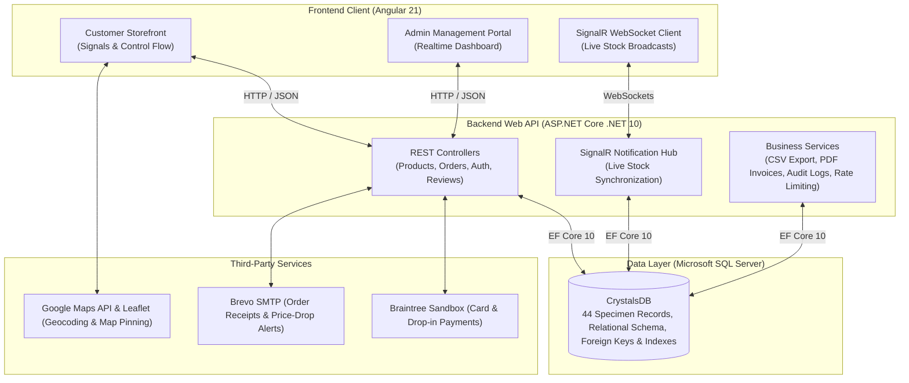

# 🔮 Crystal Studio — Luxury Metaphysical E-Commerce Platform

[](https://angular.dev/)
[](https://dotnet.microsoft.com/)
[](https://www.microsoft.com/en-us/sql-server)
[](https://www.typescriptlang.org/)
[](https://dotnet.microsoft.com/apps/aspnet/signalr)
[](https://www.braintreepayments.com/)

An artisan, full-stack enterprise e-commerce platform bridging natural healing crystal specimens with Vedic astrology, curated intention workflows, live WebSocket inventory synchronization, and digital payment processing.

---

## 🏛️ System Architecture



---

## ✨ Key Features

### 🛍️ Customer Storefront
- **Curated Mineral Taxonomy:** Browse specimens categorized into Raw Stones, Tumbled Crystals, Generators & Towers, Spheres, Palm Stones, and Artisan Jewelry.
- **Shop by Sacred Intention:** Database-driven spiritual categorization with direct SQL Server query execution:
  - ✦ **Wealth & Success** *(Abundance, Magnetism & Prosperity)*
  - ✦ **Love & Harmony** *(Compassion & Heart Awakening)*
  - ✦ **Protection & Grounding** *(Aura Shielding & Negative Energy Clearing)*
  - ✦ **Peace & Sleep** *(Calmness, Anxiety Relief & Restorative Rest)*
  - ✦ **Clarity & Intuition** *(Third Eye Vision & Wisdom)*
  - ✦ **Vitality & Energy** *(Passion, Stamina & Pranic Fire)*
- **Vedic Astrology Integration:** Filter crystals matched to traditional Vedic Moon Signs (*Mesha, Vrishabha, Mithuna, Karka, Simha, Kanya, Tula, Vrishchika, Dhanu, Makara, Kumbha, Meena*).
- **Modern D2C "Load More" Experience:** A luxury progress bar with real-time percentage fill and crystal counter (`Viewing X of Y crystals`), completely eliminating awkward split pagination.
- **Interactive Specimen Details:** 
  - Care specs: Water Safety warnings and Sunlight Exposure guidelines.
  - Metaphysical attributes: Primary Chakra resonance and Elemental alignment.
  - Pincode delivery estimator with instant turnaround estimates.
  - Customer review system with approved ratings and photo uploads.
- **Moon Transit Bar:** Real-time lunar phase calculation with cosmic cleansing guides and energetic transit advice.
- **Interactive Crystal Quiz:** Recommends personalized crystals according to emotional state and astrological coordinates.

### 💳 Checkout & Order Processing
- **Braintree Drop-in Integration:** Secure credit/debit card tokenization and sandbox payment processing.
- **Google Maps Geocoding & Leaflet:** Autocomplete address lookups with interactive map pinning for delivery accuracy.
- **Promotions & Loyalty:** Coupon codes with per-user usage limits and loyalty reward points deduction.
- **Delivery Instructions:** Custom door/apartment drop-off notes saved with each order.
- **Automated PDF Invoices:** Built via QuestPDF with itemized Indian Rupee (`₹`) breakdowns.

### ⚡ Admin Management Portal (`/admin`)
- **Real-Time Stock Synchronization:** Uses ASP.NET Core SignalR WebSockets to broadcast stock level deltas instantly across all connected screens.
- **Product Management:** Full CRUD with image manager, compare-at pricing, Marketing Ribbon badges (*Bestseller, Rare Specimen, Trending, Collector's Pick*), and Sacred Intention curation.
- **Order Detail Drawer:** Real-time status progression (*Placed &rarr; Processing &rarr; Shipped &rarr; Delivered &rarr; Cancelled*) with cancellation reason tracking.
- **Audit Logging:** Logs all administrative mutations (price changes, status updates, deletions) into a dedicated audit trail.
- **Review Moderation:** Approve, flag, or reject customer reviews and customer-uploaded specimen photos.
- **CSV Data Export:** Export the entire product catalog to CSV with a single click.

---

## 🛠️ Technology Stack

| Layer | Technology | Version | Purpose |
| :--- | :--- | :--- | :--- |
| **Frontend Framework** | Angular | `21.2` | Single Page Application with Standalone Components & Signals |
| **State Management** | Angular Signals | `v21` | High-performance reactive state (`signal`, `computed`) |
| **Styling & Design** | SCSS + CSS Tokens | Custom | Energy Muse mineral aesthetic (Ivory, Obsidian, Glowing Copper) |
| **Realtime Client** | `@microsoft/signalr` | `10.0` | Live WebSocket inventory updates |
| **Maps & Location** | Leaflet + Google Places | `1.9.4` | Interactive delivery pin and location autocomplete |
| **Backend Framework** | ASP.NET Core | `.NET 10.0` | High-performance RESTful Web API |
| **ORM & Data Access** | Entity Framework Core | `10.0.11` | Code-first / Database-first mapping with LINQ queries |
| **Database** | Microsoft SQL Server | `2022 / Express` | Relational storage with foreign keys, indexes, and triggers |
| **Realtime Server** | ASP.NET Core SignalR | `.NET 10.0` | Push notifications and inventory broadcasts |
| **Payment Gateway** | Braintree SDK | `5.41.0` | Secure payment tokenization and transactions |
| **PDF Generation** | QuestPDF + SkiaSharp | `2024.10` | Server-rendered tax invoices and order receipts |
| **Email Service** | MailKit + Brevo | `4.18.1` | Transactional emails, password recovery, price alerts |

---

## 📂 Repository Structure

```
ZodiacCrystal/
├── DB/                                # Database Assets
│   ├── Migrations/                    # Versioned SQL migration scripts
│   │   ├── 2026-10-27_product_marketing_badge.sql
│   │   └── 2026-11-06_product_intention.sql   # Sacred Intention migration
│   └── Schema/                        # Full database schema export (CrystalsDB.sql)
│
├── Frontend/                          # Angular 21 Client Application
│   ├── src/
│   │   ├── app/
│   │   │   ├── admin/                 # Admin Dashboard, Products, Orders, Reviews
│   │   │   ├── components/            # Navbar, ProductCard, Toast, Pager, Map
│   │   │   ├── models/                # TypeScript interfaces (Product, Order, User)
│   │   │   ├── pages/                 # Home, Products, Product Details, Cart, Checkout
│   │   │   ├── services/              # API services (Product, Order, Auth, Cart)
│   │   │   └── utils/                 # Intentions, Slug generators, Formatting
│   │   └── styles.scss                # Design system tokens and responsive rules
│   └── package.json
│
└── Zodiac Crystal/                    # ASP.NET Core .NET 10 Web API
    └── Zodiac Crystal/
        ├── Controllers/               # REST Endpoints (Products, Orders, Auth, etc.)
        ├── DTOs/                      # Data Transfer Objects & request validation
        ├── Hubs/                      # SignalR WebSocket hubs for stock broadcast
        ├── Models/                    # Entity Framework Core entities
        ├── Services/                  # Business logic (CSV, PDF, AuditLog, Email)
        └── appsettings.json           # Connection strings, JWT & API credentials
```

---

## 🚀 Getting Started

### Prerequisites
- [.NET 10.0 SDK](https://dotnet.microsoft.com/download)
- [Node.js (v20 or v22 LTS)](https://nodejs.org/)
- [Microsoft SQL Server / SQL Server Express](https://www.microsoft.com/en-us/sql-server/sql-server-downloads)

---

### 1. Database Setup
1. Open **SQL Server Management Studio (SSMS)** or execute using `sqlcmd`.
2. Create and seed the initial database using the schema script:
   ```powershell
   sqlcmd -S "YOUR_SERVER_NAME\SQLEXPRESS" -i "DB\Schema\CrystalsDB.sql"
   ```
3. Run the latest migrations to enable marketing badges and sacred intentions:
   ```powershell
   sqlcmd -S "YOUR_SERVER_NAME\SQLEXPRESS" -d CrystalsDB -i "DB\Migrations\2026-10-27_product_marketing_badge.sql"
   sqlcmd -S "YOUR_SERVER_NAME\SQLEXPRESS" -d CrystalsDB -i "DB\Migrations\2026-11-06_product_intention.sql"
   ```

---

### 2. Backend API Setup
1. Navigate to the backend directory:
   ```bash
   cd "Zodiac Crystal/Zodiac Crystal"
   ```
2. Verify your database connection string in `appsettings.json`:
   ```json
   "ConnectionStrings": {
     "CrystalsDb": "Server=localhost\\SQLEXPRESS;Database=CrystalsDB;Trusted_Connection=True;TrustServerCertificate=True;"
   }
   ```
3. Restore packages and run the API:
   ```bash
   dotnet restore
   dotnet run
   ```
   *The backend will boot and listen on `http://localhost:5275` (Swagger available at `/swagger`).*

---

### 3. Frontend Client Setup
1. Open a new terminal and navigate to the frontend directory:
   ```bash
   cd Frontend
   ```
2. Install npm dependencies:
   ```bash
   npm install
   ```
3. Start the Angular development server:
   ```bash
   npm start
   ```
   *Open your browser and navigate to `http://localhost:4200`.*

---

## 📱 Mobile Responsiveness & Accessibility
- **Apple HIG / Material Design:** All interactive buttons and inputs adhere to the **44px minimum touch target standard**.
- **Touch-Friendly Controls:** Features horizontal kinetic swipe rails for sub-categories and intention pills (`-webkit-overflow-scrolling: touch`).
- **Responsive 2-Column Catalog:** Mobile screens (`<= 640px`) automatically arrange crystals into a balanced two-column grid.
- **Sticky Actions:** Product details and cart pages provide fixed bottom action bars with `env(safe-area-inset-bottom)` support for notch/home-indicator devices.
- **Accessibility:** Color palettes strictly pass **WCAG AA** contrast ratios; includes full support for `prefers-reduced-motion`.

---

## 🔑 Default Roles & Accounts

| Role | Email | Access Scope |
| :--- | :--- | :--- |
| **Admin** | `princebhalodiya1111@gmail.com` | Full administrative access to `/admin` (Products, Orders, Stock, Reviews, Settings) |
| **Customer** | Register via `/register` or `/login` | Browse, order, review, track, save addresses, manage wishlist |

---

## 📜 Academic Evaluation & Viva Highlights

When presenting this project for evaluation, highlight these technical achievements:
1. **End-to-End Database Alignment:** Features like **Sacred Intentions** and **Marketing Badges** are not static frontend filters; they are modeled in SQL Server, validated via C# DTOs, and filtered via EF Core LINQ queries.
2. **Real-Time WebSockets:** Stock counts synchronize across separate browser windows in real time without page refreshing via SignalR.
3. **Angular 21 Modern Syntax:** Built entirely with standalone components, signals (`signal`, `computed`), and native control flow (`@if`, `@for`, `@switch`).
4. **Resilient Error Handling:** Includes SQL connection pooling, API rate limiting, debounced search inputs, and graceful image fallback handlers.

---

### 📄 License
This project is developed for educational and portfolio demonstration purposes. All rights reserved.

